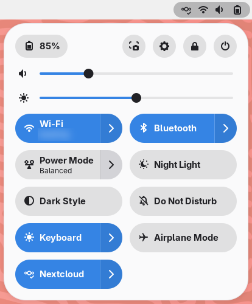

# Nextcloud QS

A GNOME Shell extension (QS: Quick Settings) that puts the [Nextcloud desktop client](https://github.com/nextcloud/desktop) in Quick Settings.

- **Tile:** shows the sync state. Click it to pause or resume sync, or to start Nextcloud when it isn't running.
- **Menu:** the arrow next to the tile opens the client's own menu (open Nextcloud, open in browser, recently changed files, settings, and so on).
- **Top bar icon:** while the client runs, a small icon next to the other status icons shows its state: synced, syncing, paused, offline, warning or error.

The icons are the client's own tray icons, so they look the same as in the Nextcloud client.



## Requirements

- GNOME Shell 51.
- The Nextcloud desktop client.

That's all for the client from your distribution (Fedora, Debian, Ubuntu, Arch, …) or Flathub: those builds support CloudProviders, which the extension uses.

Nextcloud's own AppImage is built without CloudProviders. For it, also install an extension that provides tray icons, such as [AppIndicator and KStatusNotifierItem Support](https://extensions.gnome.org/extension/615/appindicator-support/); the extension then reaches the client through its tray icon. Without either, the tile says "Not found".

### Known limitations

- With CloudProviders alone, "offline" means your computer has no network. If the network works but your server can't be reached, the tile can't tell; the client doesn't report it there. When the client's tray icon is also available, the extension uses its state, which does show this.

## Languages

Through CloudProviders, pausing works in any language. Through the tray icon, clicking the tile clicks the client's own "Pause sync" or "Resume sync" menu entry. To find it in any language, the extension ships `translations.json`: those labels in every language the client is translated into, taken from the client's translation files in [nextcloud/desktop](https://github.com/nextcloud/desktop/tree/master/translations) by `tools/extract-translations.py`.

A weekly GitHub Actions job refreshes the file and opens a pull request when Nextcloud's translations change. `./build.sh translations` does the same locally.

## Install from source

```sh
./build.sh install    # packs the extension and installs it for your user
```

Then log out and back in (on Wayland GNOME Shell only loads extension code at login), and enable it in Extensions or with:

```sh
gnome-extensions enable nextcloud-quick-settings@k0-3n.github.io
```

Also: `./build.sh pack` builds `dist/nextcloud-qs.zip` (the file to upload to extensions.gnome.org; releases are named `nextcloud-qs-v1.zip` and so on), `./build.sh uninstall` removes it again.

## Releases

GitHub Actions builds the zip on every push. Pushing a tag like `v2` also creates a GitHub release with the zip attached, with the tag as its `version-name`; that zip is what gets uploaded to extensions.gnome.org. Nothing needs compiling.

## How it works

The extension reaches the client in two ways, both over D-Bus:

- `cloudproviders.js`: [CloudProviders](https://gitlab.gnome.org/World/libcloudproviders), exported by the client as `com.nextcloudgmbh.Nextcloud`. One account object per sync folder, with its status, its menu (`org.gtk.Menus`) and its actions (`org.gtk.Actions`), including `pause`, an on/off action. The tile pauses all sync folders, or resumes them when they're all paused.
- `tray.js`: the client's tray icon (StatusNotifierItem with the id `Nextcloud`) and its menu (dbusmenu). It follows the icon name (`state-ok`, `state-sync`, `state-pause`, …) and clicks the pause/resume entry by its label (from `translations.json`).

`client.js` combines them: CloudProviders for pausing and the menu, the tray icon's state when it's there (it knows about an unreachable server), and GNOME's network status for "offline" otherwise. None of these files import GNOME Shell, so they can be tested with plain `gjs`.

## License

GPL-2.0-or-later, see [LICENSE](LICENSE). The icons in `icons/` come from the Nextcloud desktop client (GPL-2.0), see [icons/README](icons/README).
